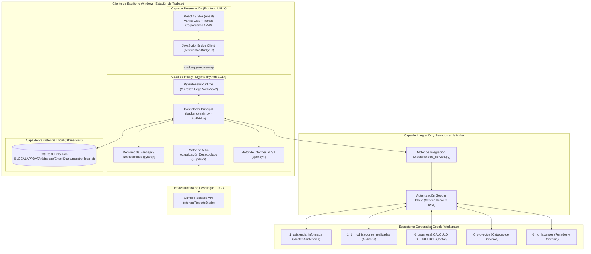
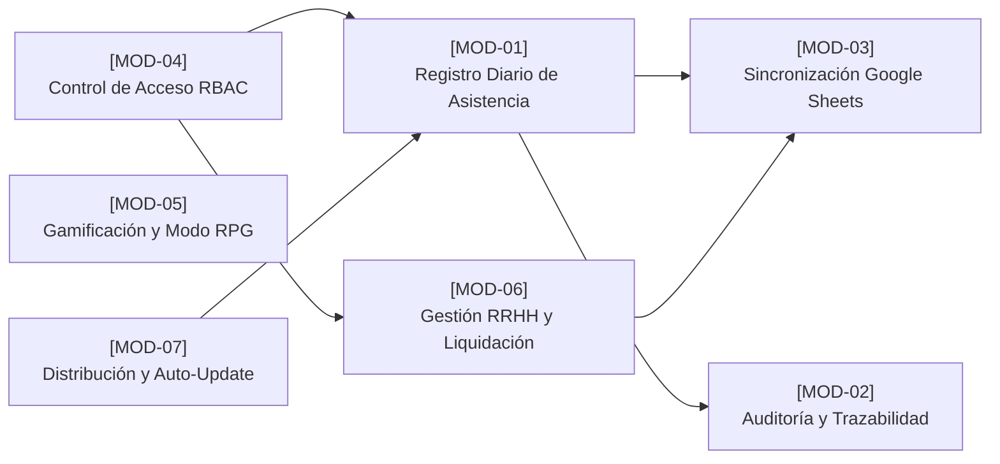

# Documento Técnico Maestro: Check Diario Ingeap (Aplicación de Escritorio)

**Sistema:** Check Diario Ingeap  
**Versión del Software:** 1.14.0  
**Fecha de Emisión:** Octubre 2026  
**Organización:** Ingeap - Automatización, Ingeniería y Control  
**Área Responsable:** Desarrollo e Innovación de Software / Recursos Humanos  
**Estándares de Referencia:** ISO/IEC/IEEE 42010 (Architecture Description), ISO/IEC/IEEE 29148 (Requirements Engineering)  
**Estado:** Producción / Operativo  

---

## 1. Resumen Ejecutivo y Propósito del Sistema

### 1.1. Propósito y Alcance
**Check Diario Ingeap** es una aplicación corporativa de escritorio diseñada para la gestión, registro, control operativo, auditoría y liquidación salarial de las jornadas laborales y horas imputadas a proyectos por los colaboradores de la empresa.

El sistema fue concebido como el reemplazo evolutivo de soluciones basadas en plataformas No-Code (AppSheet) y planillas de cálculo no centralizadas. Su objetivo primordial es garantizar la continuidad de registro en campo sin dependencia de conexión a internet, asegurar la integridad matemática de los costos imputados a los centros de costo y dotar a la administración de RRHH de herramientas de planificación (Roster) y auditoría comparativa en tiempo real.

### 1.2. Problemática Previa vs. Solución de Ingeniería Implementada

```
+-------------------------------------------------------+-------------------------------------------------------+
|             Situación Previa (AppSheet / Sheets)      |             Solución Actual (Check Diario Ingeap)     |
+-------------------------------------------------------+-------------------------------------------------------+
| - Dependencia 100% de conexión constante a internet.  | - Arquitectura Offline-First con SQLite 3 embebido.   |
| - Pérdida de reportes en zonas de campo/obra sin red. | - Cola transaccional asíncrona tolerante a fallos.    |
| - Sin integración con el sistema operativo Windows.   | - Demonio en Bandeja del Sistema (System Tray).       |
| - Olvidos frecuentes en la carga diaria de jornadas.  | - Notificaciones activas automáticas (16:30 hs).      |
| - Cálculos salariales y liquidación manuales en RRHH. | - Calculadora de liquidación con prorrateo exacto.    |
| - Modificaciones invisibles sin trazabilidad.         | - Auditoría integral de deltas (antes vs después).    |
| - Tiempos de carga elevados en interfaces genéricas.  | - SPA reactiva en React 19 (< 50ms de respuesta).     |
+-------------------------------------------------------+-------------------------------------------------------+
```

---

## 2. Topología y Arquitectura del Sistema

El sistema implementa el patrón **Desktop Hybrid Architecture (Single-Page Application sobre WebView Nativo de Windows)** acoplado a un motor local transaccional **Offline-First** con sincronización reactiva hacia Google Workspace.

### 2.1. Diagrama de Arquitectura Multicapa



### 2.2. Ciclo de Vida del Proceso de Escritorio
1. **Verificación de Instancia Única:** Al iniciar `main()`, se invoca `asegurar_instancia_unica()`. Mediante la API de Windows (`win32event.CreateMutex` sobre `Local\CheckDiarioIngeap_SingleInstance_Mutex`), si ya existe una instancia ejecutándose, se restaura la ventana existente y el proceso duplicado finaliza inmediatamente (`sys.exit(0)`).
2. **Autoarranque del Sistema:** `asegurar_inicio_automatico()` comprueba y escribe en el Registro de Windows (`HKCU\Software\Microsoft\Windows\CurrentVersion\Run`) la ruta del ejecutable para garantizar que la aplicación inicie minimizada en cada inicio de sesión de Windows.
3. **Inicialización de Base de Datos y Migraciones Defensivas:** `inicializar_bd()` comprueba la existencia del archivo SQLite y ejecuta sentencias `ALTER TABLE` defensivas para agregar columnas de nuevas versiones (como `cargado_por`, `tipo_costo`, `costo_dia`, `rol_app`) sin destruir datos preexistentes.
4. **Verificación de Versión e Instalación:** Si `version_previa != APP_VERSION`, se dispara un hilo de actualización que resincroniza completamente la base local contra Google Sheets y asienta la nueva versión instalada.
5. **Lanzamiento de Demonios en Segundo Plano:**
   - **Demonio de Bandeja (`pystray`):** Icono persistente en el System Tray con menú contextual (Abrir, Ocultar, Salir) y captura del evento de cierre de ventana para minimizar en lugar de terminar el proceso.
   - **Demonio de Recordatorios Diarios:** Hilo continuo que verifica:
     - *Al iniciar el equipo:* Alerta al usuario si no ha registrado la jornada previa o actual.
     - *A las 16:30 hs:* Alarma programada que evalúa si el usuario activo ya registró su jornada de hoy; de no ser así, despliega la ventana y emite una notificación nativa de Windows.
   - **Hilos de Sincronización en Background:** Sincronización continua de la cola de registros pendientes, refresco de catálogos y descarga de modificaciones.
6. **Arranque de PyWebView:** Se inicializa la ventana Edge WebView2 vinculando la instancia de `ApiPuente` al objeto JavaScript `window.pywebview.api`.

---

## 3. Pila Tecnológica (Tech Stack) y Racional de Ingeniería

| Capa | Tecnología Seleccionada | Justificación de Ingeniería y Alternativas Descartadas |
| :--- | :--- | :--- |
| **Frontend Framework** | **React 19 + JavaScript (ESNext)** | Modelo de componentes declarativo, gestión reactiva de estados complejos (formularios multiproyecto, calendarios interactivos, modales) y compatibilidad con el React Compiler. Se descartó Vanilla JS por complejidad de estado y Angular/Vue por overhead de bundle. |
| **Herramienta de Build** | **Vite 8** | Compilación ultrarrápida (sub-segundo) con Rollup/ESBuild, Hot Module Replacement instantáneo y optimización de tree-shaking generando bundles mínimos embebibles en el backend (`../backend/dist`). |
| **Estilos & UI** | **Vanilla CSS (Diseño Tokenizado)** | Sistema de diseño corporativo sin dependencias pesadas de runtime. Paleta institucional (`#C81E2B`, Slate), modo oscuro nativo y modo de fantasía RPG mediante variables CSS dinámicas (`[data-theme]`). |
| **Desktop Host / Bridge** | **Python 3.11+ / PyWebView 5.x** | **Ventaja crítica:** Utiliza el motor nativo del SO (*Microsoft Edge WebView2 Evergreen*). Reduce el tamaño del instalador de **~180 MB (en Electron) a solo 28 MB**, y el consumo de RAM de **~250 MB a ~50 MB**, comunicando Python y JS sin sockets HTTP intermedios. |
| **Persistencia Local** | **SQLite 3 (Embebido)** | Motor transaccional serverless con cumplimiento estricto de propiedades ACID, índices B-Tree para consultas cronológicas instantáneas, resiliencia ante cortes de energía y funcionamiento 100% Offline-First. |
| **Integración Cloud** | **Google Cloud Service Account + `gspread`** | Conexión directa y desatendida mediante clave RSA con las planillas de Google Sheets de la empresa, evitando costos fijos de servidores de base de datos en la nube y permitiendo integración transparente con Looker Studio y Google Drive. |
| **Demonio de Bandeja** | **Pystray + Pillow** | Control multiplataforma de íconos en la bandeja de Windows, gestión de menús contextuales y emisión de notificaciones de escritorio desacopladas del ciclo de vida de la ventana gráfica. |
| **Generación de Informes** | **Openpyxl 3.1+** | Motor de generación de libros binarios de Microsoft Excel (`.xlsx`) con estilos tipográficos institucionales, fórmulas automáticas y reportes multihoja ejecutivos. |
| **Empaquetado** | **PyInstaller 6.x** | Congelación de scripts Python y assets precompilados del frontend en ejecutables independientes sin requerir Python en las máquinas de los usuarios. |

---

## 4. Módulos Funcionales y Reglas de Negocio Operativas



### 4.1. [MOD-01] Registro de Asistencia Diaria
* **Funcionalidad:** Formulario interactivo para que los colaboradores imputen su jornada laboral.
* **Modalidades de Jornada:**
  - `Oficina`: Jornada estándar en sede (8 hs por defecto).
  - `Campaña / Campo`: Jornadas en obra/terreno con selectores horarios (`hora_inicio`, `hora_fin`) que calculan horas decimales automáticamente, soportando cruces de medianoche.
  - `Franco`: Día no laborable compensatorio o de descanso.
  - `Licencia` y `Vacaciones`: Justificaciones laborales con selectores específicos.
* **Reglas de Negocio:**
  - **Imputación Multiproyecto:** Un colaborador puede dividir su jornada entre múltiples proyectos (ej. 4 hs Proyecto A y 4 hs Proyecto B). La columna `costo_dia` se calcula y prorratea proporcionalmente a las horas de cada proyecto sin inflar el costo total de la jornada.
  - **Tipificación Avanzada de Francos:**
    - *Franco de Oficina:* 0 hs imputadas al área, costo de oficina estándar.
    - *Franco de Obra:* Aplica para operarios de campo en régimen de descanso de campaña.
    - *Franco Trabajado al 150%:* Remunera con recargo del 50% sobre la tarifa base (diferenciado entre Franco Obra Trabajado y Franco Oficina Trabajado).
    - *Feriado Trabajado al 200%:* Remunera con recargo del 100% sobre la tarifa base.
  - **Detección Automática de Feriados:** Cruce inmediato con el catálogo local `0_no_laborales` para marcar el campo booleano `feriado = "SI"` o `"NO"`.

### 4.2. [MOD-02] Auditoría y Trazabilidad de Modificaciones
* **Funcionalidad:** Registro exhaustivo de cualquier edición o eliminación aplicada sobre jornadas históricas.
* **Reglas de Negocio:**
  - Si un colaborador o RRHH edita un registro, el sistema genera un registro de auditoría (*delta tracking*) almacenando: `tipo_antes`, `tipo_despues`, `horas_antes`, `horas_despues`, `servicio_antes`, `servicio_despues`, `quien_modifica` y marca de tiempo ISO.
  - Los deltas se guardan localmente en `modificaciones_realizadas` y se sincronizan en la hoja remota `1_1_modificaciones_realizadas`.
  - El panel de RRHH visualiza insignias (*badges*) ámbar en el calendario y permite marcar las modificaciones como revisadas (`revisado = 1`), eliminando alertas pendientes.

### 4.3. [MOD-03] Motor de Sincronización Remota Bidireccional
* **Funcionalidad:** Enlace transaccional entre la base SQLite local y el ecosistema Google Sheets.
* **Reglas de Negocio:**
  - **Idempotencia basada en UUIDv4:** Cada asistencia cuenta con un identificador universal único (`id_asistencia`).
  - **Cola de Reintentos Tolerante a Fallas:** Si no hay internet, el registro se asienta con `sincronizado = 0`. Al reconectar, el hilo de fondo sube las filas pendientes mediante `append_rows` o actualiza celdas existentes mediante búsqueda por UUID.
  - **Deduplicación Estricta:** La deduplicación se realiza exclusivamente por `id_asistencia`, preservando jornadas divididas legítimas en un mismo día y proyecto.
  - **Sincronización en Caliente de Catálogos:** `refrescar_catalogos_sheets` descarga periódicamente los proyectos vigentes (`0_proyectos`), empleados autorizados (`0_usuarios`) y feriados (`0_no_laborales`).

### 4.4. [MOD-04] Control de Acceso y Sistema de Roles RBAC (v1.14.0)
* **Funcionalidad:** Matriz de control de acceso basada en la columna `rol_app` de la hoja `0_usuarios`.
* **Roles Definidos:**
  - **`admin`:** Acceso irrestricto total (registro propio y delegado, historial personal y global, Roster, calculadora salarial, revisión de modificaciones, gestión de tipos de costo y rangos de fechas).
  - **`sub_admin`:** Acceso a registro personal, visualización de actividad de ayer y suite completa de RRHH (Roster, calculadora salarial, historial de otros colaboradores con edición/eliminación y revisión de modificaciones).
  - **`core`:** Registro diario personal con facultad de seleccionar "Campo", widget de actividad de ayer y acceso de **solo lectura** al historial de otros colaboradores.
  - **`user_1`:** Registro diario personal con facultad de seleccionar "Campo". Los días de franco se fijan automáticamente como Franco de Oficina (0 hs), ocultando subtipos avanzados.
  - **`user_2`:** Registro diario personal restringido estrictamente a modalidades de "Oficina" y "Franco" (**sin posibilidad de seleccionar "Campo"**).

```
+--------------------+-------------------+-------------------+-------------------+-------------------+-------------------+
| Capacidad          | admin             | sub_admin         | core              | user_1            | user_2            |
+--------------------+-------------------+-------------------+-------------------+-------------------+-------------------+
| Registro Diario    | Propio y Delegado | Propio y Delegado | Propio            | Propio            | Propio            |
| Jornada de Campo   | Habilitada        | Habilitada        | Habilitada        | Habilitada        | Bloqueada         |
| Subtipos de Franco | Avanzados (Todos) | Avanzados (Todos) | Fijo (Oficina)    | Fijo (Oficina)    | Fijo (Oficina)    |
| Carga por Rango    | Habilitada        | Habilitada        | Bloqueada         | Bloqueada         | Bloqueada         |
| Actividad de Ayer  | Habilitada        | Habilitada        | Habilitada        | Bloqueada         | Bloqueada         |
| Historial Otros    | Lectura y Edición | Lectura y Edición | Solo Lectura      | Sin Acceso        | Sin Acceso        |
| Suite RRHH         | Roster + Liq + Mod| Roster + Liq + Mod| Sin Acceso        | Sin Acceso        | Sin Acceso        |
+--------------------+-------------------+-------------------+-------------------+-------------------+-------------------+
```

### 4.5. [MOD-05] Roster y Planificación Operativa Mensual
* **Funcionalidad:** Matriz interactiva tipo Gantt para la planificación de turnos de los colaboradores a lo largo de los 31 días del mes.
* **Reglas de Negocio:**
  - Permite asignar estados previstos (`Oficina`, `Campo`, `Franco`, `Licencia`).
  - Reconcilia automáticamente la planificación con los registros reales informados en el historial diario.
  - Admite selección múltiple de celdas y asignación por lotes.

### 4.6. [MOD-06] Calculadora de Liquidación Salarial y Exportación Ejecutiva
* **Funcionalidad:** Motor de cómputo salarial mensual para RRHH con generación de informes ejecutivos en Microsoft Excel (`.xlsx`).
* **Reglas de Negocio:**
  - **Regla Estricta por Tipo y Día:** Múltiples registros de una misma categoría en el mismo día computan como **1 solo día** salarial. Si coexisten modalidades combinadas (oficina + campo), se computan ambos conceptos independientemente.
  - **Incrementos de 0.5 Días:** Permite ajustes manuales con saltos decimales de medio día (`step="0.5"`).
  - **Exportación con `openpyxl`:** Genera un archivo con diseño corporativo oficial, cuadrando matemáticamente el total liquidado, el detalle cronológico y el desglose de costos imputados a cada proyecto.

### 4.7. [MOD-07] Gamificación y Modo RPG
* **Funcionalidad:** Tema visual de fantasía medieval y tablón de misiones (*Tavern Board*) exclusivo para el Área de Aplicaciones (`area === 'A'`).
* **Reglas de Negocio:**
  - Asigna títulos honoríficos dinámicos según el perfil (ej. *"Alquimista Supremo de Automatizaciones"*, *"Gran Canciller de Recompensas"*).
  - Mantiene las validaciones operativas y de seguridad estrictas del sistema bajo una estética temática inmersiva.

### 4.8. [MOD-08] Infraestructura de Actualización Desacoplada
* **Funcionalidad:** Detección y aplicación desatendida de nuevas versiones del software.
* **Reglas de Negocio:**
  - Consulta la API pública de GitHub Releases (`https://api.github.com/repos/Aterian/ReporteDiario/releases`).
  - Si `version_remota > APP_VERSION`, notifica al usuario con un banner interactivo.
  - Al confirmar, descarga el binario `CheckDiarioIngeap.exe`, ejecuta el proceso `--updater` que reemplaza el archivo ejecutable en disco y relanza la aplicación preservando la base de datos local.

---

## 5. Esquema de Base de Datos y Mapeo de Entidades

### 5.1. Tablas Locales SQLite (`registro_local.db`)

```sql
-- 1. Tabla Principal de Asistencias Diarias (18 columnas)
CREATE TABLE IF NOT EXISTS asistencias (
    id INTEGER PRIMARY KEY AUTOINCREMENT,
    id_asistencia TEXT UNIQUE NOT NULL,      -- UUIDv4 universal
    empleado TEXT NOT NULL,
    fecha TEXT NOT NULL,                     -- Formato ISO YYYY-MM-DD
    tipo_dia TEXT NOT NULL,                  -- Oficina, Campo, Franco, etc.
    servicio TEXT NOT NULL,                  -- Código y nombre de proyecto
    hora_inicio TEXT,                        -- HH:MM
    hora_fin TEXT,                           -- HH:MM
    horas REAL NOT NULL,                     -- Cantidad de horas decimales
    instrumental TEXT,
    usuario_mail TEXT,
    fecha_hora TEXT NOT NULL,                -- Timestamp ISO de creación
    dia_semana TEXT NOT NULL,                -- lunes, martes, etc.
    feriado TEXT NOT NULL DEFAULT 'NO',      -- SI / NO
    id_empleado TEXT,
    id_proyecto TEXT,
    cargado_por TEXT,                        -- Mail de quien realizó la carga
    tipo_costo TEXT,                         -- Normal, Franco Trabajado 150%, etc.
    costo_dia REAL DEFAULT 0,                -- Monto salarial prorrateado
    sincronizado INTEGER DEFAULT 0           -- 0 = Pendiente, 1 = En la nube
);

-- 2. Tabla de Auditoría de Modificaciones
CREATE TABLE IF NOT EXISTS modificaciones_realizadas (
    id INTEGER PRIMARY KEY AUTOINCREMENT,
    id_asistencia TEXT NOT NULL,
    empleado TEXT NOT NULL,
    fecha_registro TEXT NOT NULL,
    campo_modificado TEXT NOT NULL,
    valor_anterior TEXT,
    valor_nuevo TEXT,
    usuario_editor TEXT NOT NULL,
    fecha_modificacion TEXT NOT NULL,
    revisado INTEGER DEFAULT 0,
    sincronizado INTEGER DEFAULT 0
);

-- 3. Tablas de Caché y Sesión
CREATE TABLE IF NOT EXISTS usuarios_cache (
    id INTEGER PRIMARY KEY AUTOINCREMENT,
    nombre TEXT NOT NULL,
    dni TEXT UNIQUE NOT NULL,
    mail TEXT,
    area TEXT,
    rol_app TEXT DEFAULT 'user_1',
    costo_dia_obra REAL DEFAULT 0,
    costo_dia_ofi REAL DEFAULT 0,
    avatar_base64 TEXT
);

CREATE TABLE IF NOT EXISTS proyectos_cache (
    id INTEGER PRIMARY KEY AUTOINCREMENT,
    codigo TEXT NOT NULL,
    nombre TEXT NOT NULL,
    area TEXT NOT NULL
);

CREATE TABLE IF NOT EXISTS no_laborales_cache (
    fecha TEXT PRIMARY KEY,
    descripcion TEXT,
    tipo TEXT
);

CREATE TABLE IF NOT EXISTS sesion (
    id INTEGER PRIMARY KEY CHECK (id = 1),
    dni TEXT NOT NULL,
    nombre TEXT NOT NULL,
    mail TEXT,
    area TEXT,
    rol_app TEXT DEFAULT 'user_1'
);

CREATE TABLE IF NOT EXISTS rosters (
    id INTEGER PRIMARY KEY AUTOINCREMENT,
    empleado TEXT NOT NULL,
    mes_anio TEXT NOT NULL,                  -- Formato YYYY-MM
    dia INTEGER NOT NULL,                    -- 1 al 31
    tipo_dia TEXT NOT NULL,
    proyecto TEXT
);
```

### 5.2. Mapeo con Hojas de Google Sheets
- **`asistencias`** $\longleftrightarrow$ **`1_asistencia_informada`**: Mapeo directo y posicional de 18 columnas. Sincronización gobernada por el campo `id_asistencia` como clave primaria de conciliación.
- **`modificaciones_realizadas`** $\longleftrightarrow$ **`1_1_modificaciones_realizadas`**: Mapeo de 10 columnas para trazabilidad de deltas y auditoría administrativa.
- **`usuarios_cache`** $\longleftrightarrow$ **`0_usuarios` & `CALCULO DE SUELDOS`**: Fuente maestra de empleados, correos corporativos, áreas y tarifas salariales base.
- **`proyectos_cache`** $\longleftrightarrow$ **`0_proyectos`**: Catálogo corporativo de obras y contratos vigentes.
- **`no_laborales_cache`** $\longleftrightarrow$ **`0_no_laborales`**: Calendario oficial de feriados y asuetos.

---

## 6. Protocolos y Estándares de Desarrollo Aplicados

### 6.1. Protocolo de Identificación y Trazabilidad de Código
- **Módulos del Sistema:** Identificados formalmente mediante la convención `[MOD-XX]` (ej. `// [MOD-04] Control de Permisos y Roles`).
- **Funcionalidades Específicas:** Identificadas en cabeceras de funciones mediante la convención `[FN-XX.YY]` (ej. `# [FN-01.09] Prorrateo multiproyecto`).
- **Catálogo de Memoria:** Registro centralizado en `.agents/functional_catalog.md` que documenta cada feature, flujo operativo, tablas afectadas e invariantes de negocio.

### 6.2. Protocolo de Gestión de Versiones y Flujo Git
- **Branching Model:** Cada actualización o feature se desarrolla en ramas dedicadas (`feat/<nombre>` o `fix/<nombre>`), garantizando que la rama principal permanezca en estado desplegable.
- **Conventional Commits:** Uso estricto de prefijos estandarizados (`feat:`, `fix:`, `chore:`, `refactor:`, `style:`).
- **SemVer (Semantic Versioning):** Incremento sistemático del número de versión `MAJOR.MINOR.PATCH` sincronizado en:
  - `frontend/package.json` (`"version": "1.14.0"`)
  - `backend/main.py` (`APP_VERSION = "1.14.0"`)
  - `REGISTRO_DE_VERSIONES.md` (Changelog cronológico detallado).
- **Tags Anotados en Git:** Generación de tags criptográficamente fechados (`v1.14.0`) vinculados a los commits de release en GitHub.

### 6.3. Protocolo de Integridad de Datos y Concurrencia
- **Cerrojos de Sincronización:** Uso de `threading.Lock()` (`_sync_lock` en `sheets_service.py`) para evitar condiciones de carrera entre hilos simultáneos de sincronización en segundo plano.
- **Transacciones ACID:** Todas las mutaciones locales en SQLite se ejecutan bajo bloques de transacción explícitos (`BEGIN TRANSACTION` / `COMMIT`), revirtiendo cambios ante cualquier excepción de I/O.
- **Preservación de Auditoría:** Las eliminaciones no son destructivas a nivel corporativo; generan registros de trazabilidad antes de depurarse de la vista del usuario.

### 6.4. Pipeline de Compilación y Distribución
La compilación de producción se encuentra automatizada en `compilar_instalador.bat` mediante una secuencia de 4 etapas:
1. **Compilación de Frontend:**
   ```cmd
   cd frontend && npm run build
   ```
   Genera el bundle estático minificado en `backend/dist`.
2. **Empaquetado de la Aplicación Principal:**
   ```cmd
   cd backend && pyinstaller --clean --distpath "..\instalador" CheckDiarioIngeap.spec
   ```
   Genera `instalador\CheckDiarioIngeap.exe` (26.88 MB) conteniendo el runtime de Python, Edge WebView2 bridge y los assets del frontend.
3. **Empaquetado del Instalador Autónomo:**
   ```cmd
   cd backend && pyinstaller --clean --distpath "..\instalador" Instalador_CheckDiario_Ingeap.spec
   ```
   Genera `instalador\Instalador_CheckDiario_Ingeap.exe` (32.86 MB), un instalador de archivo único con interfaz gráfica que descomprime el ejecutable en `%LOCALAPPDATA%\Ingeap\CheckDiario`, crea accesos directos en el Escritorio y configura el autoarranque en el Registro de Windows.
4. **Validación y Publicación en GitHub Releases:**
   - Creación del Release oficial en el repositorio GitHub (`Aterian/ReporteDiario`).
   - Carga binaria automatizada vía REST API de los dos ejecutables como assets de descarga pública.

---

## 7. Conclusión Técnica

**Check Diario Ingeap** representa una solución de ingeniería de escritorio consolidada, eficiente y adaptada a las complejidades operativas de una empresa de ingeniería y automatización en campo. Su arquitectura híbrida con PyWebView y Edge WebView2 optimiza el consumo de recursos de hardware, mientras que su motor SQLite y protocolo de sincronización por UUID garantizan disponibilidad ininterrumpida y consistencia matemática de datos bajo cualquier escenario de conectividad.
